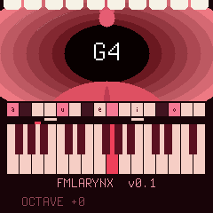

# FMLarynx

FMLarynx turns the M-VAVE FM-1 into a throaty talking formant synth with a 303-style pattern sequencer. A saw wave
goes through a three-formant vowel filter with an envelope, a resonant low-pass, drive and a ping-pong delay. The 16
steps have a vowel, accent and slide each, there is a pattern randomizer, and 16 patterns are stored on the white keys.

This is version {{VERSION}}. You install it at your own risk, and the installer can put M-VAVE's own firmware back.

- [Try it in the browser](emu/). Play it right here, with sound. It runs the same code as the FM-1.
- [Install](install/) it from Chrome or Edge, with the FM-1 connected by USB.
- The [README](https://github.com/ejtb76/FMLarynx#readme) explains the controls, the sequencer and MIDI.
- [Download {{PKG}}](firmware/{{PKG}}) to use the command-line installer: `python3 base/tools/fm1_install.py {{PKG}}`.
- The [Source](https://github.com/ejtb76/FMLarynx) is under GPL-3.0. It's built on fm1-base and felucca-bsp, which
  come from Felucca by Leo Kuroshita, Hügelton Instruments.

M-VAVE and FM-1 are trademarks of their owners. FMLarynx is not affiliated with M-VAVE.
